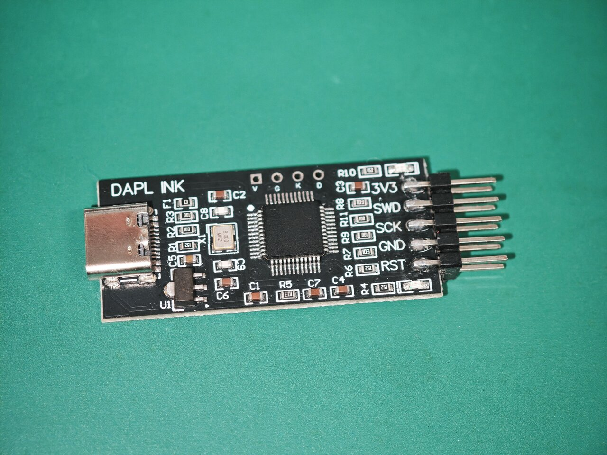
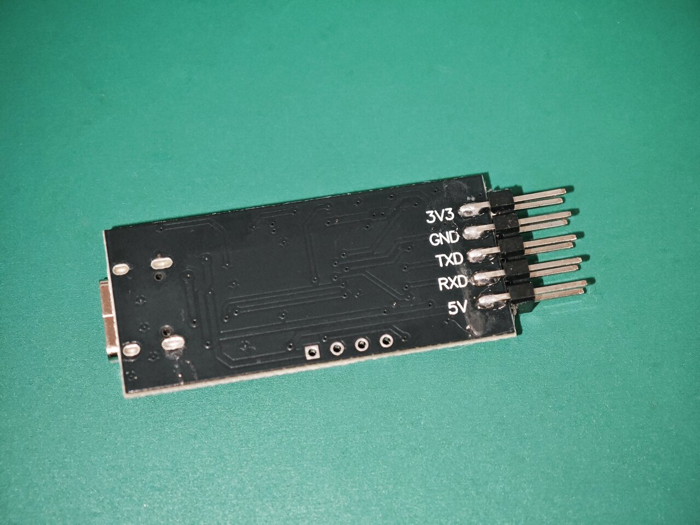

# Making the cheap AliExpress "DAPLink" clone usable

**AliExpressのコピー品DAPLINK を使い物にする** ([日本語](#日本語))

This is a fork of [devanlai/dap42](https://github.com/devanlai/dap42). It adds the target `STM32F103-JIXINLU` for a cheap probe that AliExpress sells as "DAPLink". The probe is a copy of jixin.pro's "CMSIS-DAP_LU".

**The problem:** the stock firmware is CMSIS-DAP 1.0 (HID, `c251:f001`). It lacks `DAP_SWD_Sequence` (command 0x1D), so it cannot talk to multidrop SWD targets such as the **RP2040 and RP2350**.

**The fix:** reflash the probe with dap42. It then becomes a CMSIS-DAP 2.1 (bulk) probe with a USB-serial bridge, and it works with RP2040/RP2350.

| Front | Back |
| ----- | ---- |
|  |  |

## The board

- Silkscreen: "DAPL INK". USB Type-C, no case.
- MCU: an STM32F103-compatible chip in LQFP48 with its markings removed. CPUID is `0x412FC230`, the UID reads all zeros, and the flash is 128 KiB.
- Clock: 8 MHz crystal (X1).
- The MCU's own SWD pads are `V` `G` `K` `D` on the top edge (3V3, GND, SWCLK = PA14, SWDIO = PA13). Use them to reflash.

## Pinout

The header has different silkscreen labels on each side. Every MCU pin below was checked for continuity with a multimeter.

| Label | Side | MCU pin | LQFP48 pin | Function |
| ----- | ---- | ------- | ---------- | -------- |
| SWD   | front | PA2  | 12 | SWDIO |
| SCK   | front | PA4  | 14 | SWCLK |
| RST   | front | PA6  | 16 | nRESET |
| TXD   | back  | PA9  | 30 | USART1 TX (USB-serial) |
| RXD   | back  | PA10 | 31 | USART1 RX (USB-serial) |
| 3V3 / GND / 5V | both | - | - | Power |

On the board:

| MCU pin | LQFP48 pin | Function |
| ------- | ---------- | -------- |
| PB8  | 45 | LED, CON: on while connected to a target. Active high |
| PB12 | 25 | LED, RUN/ACT: on during transfers. Active high |
| PB2  | 20 | BOOT1, pulled down only |
| PA8  | 29 | The stock firmware drives it high from boot. Its role is unknown, so dap42 drives it high too |

## Get the firmware

### Prebuilt

Download `dap42-STM32F103-JIXINLU.bin` from [Releases](https://github.com/rei512/dap42/releases). Its SHA-256 is listed in the release notes.

### Build from source

You need `git`, `make`, `python3`, and the [Arm GNU Toolchain](https://developer.arm.com/downloads/-/arm-gnu-toolchain-downloads) (`arm-none-eabi-gcc`). It was tested with arm-none-eabi-gcc 14.3.Rel1 on Linux.

```sh
git clone -b jixin-lu --recursive https://github.com/rei512/dap42.git
cd dap42
make -C libopencm3 TARGETS=stm32/f1      # first time only
make -C src TARGET=STM32F103-JIXINLU     # -> src/DAP42.bin
```

`--recursive` is required because libopencm3 is a git submodule. If you already cloned without it, run `git submodule update --init`.

The build is reproducible: with the same toolchain, a fresh clone produces a `DAP42.bin` identical to the release binary.

DFU is not supported (`DFU_AVAILABLE=0`), so every update goes through SWD.

## Back up and flash

Connect an ST-LINK (or another SWD probe) to the `V` `G` `K` `D` pads. Compatible MCUs may report a different SWD ID than a genuine STM32, so `set CPUTAPID 0` turns off the ID check.

The stock firmware is not read-protected (RDP = `0xA5`). Back it up first so you can go back to it.

```sh
# Back up the stock firmware
openocd -f interface/stlink.cfg -c "transport select swd" -c "set CPUTAPID 0" -f target/stm32f1x.cfg \
  -c init -c "reset halt" -c "flash read_bank 0 original.bin" -c shutdown

# Flash dap42
openocd -f interface/stlink.cfg -c "transport select swd" -c "set CPUTAPID 0" -f target/stm32f1x.cfg \
  -c "program src/DAP42.bin 0x08000000 verify reset exit"
```

To check that your board is the same as this one, compare the SHA-256 of your backup. The stock firmware read from this board was:

```
db8173320693b2640d1689532f280aadd0dbeaca2c417a347c6e27611b63dfaf  original.bin
```

If yours differs, the board may be a different variant, so check the pinout before flashing.

After flashing, the probe enumerates as `1209:da42` "DAP103-LU CMSIS-DAP" plus a CDC serial port.

## Usage

```sh
openocd -f interface/cmsis-dap.cfg -f target/rp2040.cfg
```

RP2350 support needs a recent OpenOCD built from git. It was tested with 0.12.0+dev (October 2026); the 0.12.0 release is too old.

On Linux, OpenOCD's udev rules (`60-openocd.rules`) already allow any device whose product name contains "CMSIS-DAP", so no extra rule is needed.

## Tested

- OpenOCD (`interface/cmsis-dap.cfg`) connects to STM32C011, RP2040 (both cores) and RP2350 (both cores).
- A UART loopback (TXD shorted to RXD) matches at 9600 and 115200 bps.
- Both LEDs light: CON and RUN/ACT.
- A failed connection with no target attached does not hang the USB.

## 日本語

AliExpress で「DAPLink」として売られている安価なプローブ (jixin.pro「CMSIS-DAP_LU」のコピー品) を、dap42 に書き換えて使えるようにするフォークです。ターゲット `STM32F103-JIXINLU` を追加しています。

- **問題:** 元のファームは CMSIS-DAP 1.0 (HID, `c251:f001`) で、`DAP_SWD_Sequence` (0x1D) がありません。そのため **RP2040 / RP2350** のマルチドロップ SWD に接続できません。
- **解決:** dap42 に書き換えると CMSIS-DAP 2.1 (bulk) と USB シリアルになり、RP2040 / RP2350 にも接続できます。
- **基板:** MCU は刻印を消した STM32F103 互換品 (LQFP48、128 KiB) で、8 MHz 水晶が載っています。MCU 自身の SWD は上辺の `V` `G` `K` `D` パッドです。
- **ピン配置:** 上の表を参照してください。テスターで導通を確認済みです。LED は PB8 (CON) と PB12 (RUN/ACT) で、どちらも H で点灯します。
- **ファーム:** [Releases](https://github.com/rei512/dap42/releases) からビルド済みの `dap42-STM32F103-JIXINLU.bin` を取得できます。自分でビルドする場合は、上の「Build from source」の手順で行います (`--recursive` 付きで clone し、最初に一度 libopencm3 をビルドする)。同じツールチェーンなら、リリースと同じバイナリになります。DFU には対応していないので、更新は毎回 SWD で行います。
- **書き込み:** `V` `G` `K` `D` に ST-LINK などをつなぎ、上のコマンドで書き込みます。元のファームはリードプロテクトが掛かっていないので、先にバックアップを取っておけば元に戻せます。バックアップの SHA-256 が上の値と違う場合は、別の基板の可能性があるので、ピン配置を確認してから書き込んでください。
- **使い方:** `openocd -f interface/cmsis-dap.cfg -f target/rp2040.cfg`。RP2350 には git 版の新しい OpenOCD が必要です。
- **動作確認:** STM32C011、RP2040 と RP2350 (どちらも両コア) に接続でき、UART ループバックと LED 2 つも確認しました。ターゲットがなくて接続に失敗しても、USB は固まりません。

---

*The original dap42 README follows. / 以下は元の dap42 の README です。*

# dap42
The dap42 project is an open-source firmware and [hardware design](https://github.com/devanlai/dap42-hardware) for an inexpensive, minimalist CMSIS-DAP based debug probe based on the [STM32F042F6](http://www.st.com/web/catalog/mmc/FM141/SC1169/SS1574/LN1823/PF259617) in a TSSOP-20 package.

This project is stable - it has been proven in the field by a few dozen users and all core functionality has been tested.

## Current features
### Firmware
* [Serial Wire Debug](https://developer.arm.com/documentation/ihi0031/a/The-Serial-Wire-Debug-Port--SW-DP-/Introduction-to-the-ARM-Serial-Wire-Debug--SWD--protocol) (SWD) access over [CMSIS-DAP 2.0](https://arm-software.github.io/CMSIS_5/DAP/html/index.html) protocol via HID interface or bulk interface (tested with [OpenOCD](https://openocd.org), [LPCXpresso](http://www.nxp.com/pages/:LPCXPRESSO) and [pyOCD](https://pyocd.io/)).
* CDC-ACM USB-serial bridge
* [Device Firmware Upgrade](https://www.usb.org/sites/default/files/DFU_1.1.pdf) (DFU) over USB (detach-only, switches to on-chip [DFuSe](http://dfu-util.sourceforge.net/dfuse.html) bootloader).
* [Serial Line CAN](https://elixir.bootlin.com/linux/latest/source/drivers/net/can/slcan/slcan-core.c) (SLCAN) interface - Silent mode, RX only.

## Flash instructions
The default method to upload new firmware is via [dfu-util](http://dfu-util.sourceforge.net/). The Makefile includes the `dfuse-flash` target to invoke dfu-util. dfu-util automatically detaches the dap42 firmware and uploads the firmware through the on-chip bootloader.

To flash via another debugger, use `make flash`.

For detailed flashing instructions, see [FLASHING.md](./FLASHING.md)

### STM32F103
The dap42 firmware can also target the STM32F103 chip.

To build firmware for STLink/v2 knockoff designs, use the `STM32F103` target or `STM32F103-DFUBOOT` target when using the [dapboot](https://github.com/devanlai/dapboot) bootloader. The CDC UART is connected to the `SWIM` pin (`PB11`) as an RX-only input.

To build firmware for the "bluepill" dev board, use the `STM32F103-BLUEPILL` or `STM32F103-BLUEPILL-DFUBOOT` targets.

The pin mapping is as follows:

| Signal | Pin  |
| ------ | ---- |
| SWDIO  | PB14 |
| SWCLK  | PB13 |
| RESET  | PB0  |
| TX     | PA2  |
| RX     | PA3  |

Note: due to hardware limitations, all STM32F103 targets as implemented are limited to one of either the CMSIS-DAP v1 HID interface or the CMSIS-DAP v2 bulk interface.
By default, all STM32F103 targets use the v2 bulk interface.
If you prefer the v1 HID interface, use the `STM32F103-HID` targets instead of `STM32F103`.

## Usage
### OpenOCD
The dap42 firmware has been tested with gdb and OpenOCD on STM32F042 (of course), STM32F103, and LPC11C14 targets.

In general, the probe can be used with OpenOCD just by specifying the cmsis-dap interface:

    openocd -f interface/cmsis-dap.cfg -f your_config.cfg -c "some inline command"

Example OpenOCD configurations can be found under the [openocd/](openocd/) folder.

### MCUXpresso
The default probe detection rules used by MCUXpresso (formerly LPCXpresso) will not auto-discover generic CMSIS-DAP probes.
To use the dap42 probe with MCUXpresso, you can modify the detection rules by editing `probetable.csv` in your MCUXpresso installation.

For MCUXpresso version 11.4 or newer, edit `probetable.csv` under `ide/plugins/com.mcuxpresso.tools.bin.<...>/binaries/Scripts`:

    0x1209, 0xDA42, 64, 1, 0, 0, 0, "", 0x0000, -1, -1

In older versions, the CSV format has one fewer entry at the end:

    0x1209, 0xDA42, 64, 1, 0, 0, 0, "", 0x0000, -1

Please note: in the most recent version of MCUXpresso, `probetable.csv` no longer exists and does not support custom CMSIS-DAP probes.

### USB-serial
#### Windows
On Windows 10, the serial port works without requiring additional configuration.

For Windows XP through Windows 7, the [DAP42CDC.inf](drivers/DAP42CDC.inf) `.inf` file can be used to load the generic USB serial driver.

#### Mac OSX
On Mac OSX version 10.7 and later, the serial port should work without requiring any additional configuration.

#### Linux
On Linux, the serial port should be detected without requiring additional configuration.
Depending on your distro settings, the modem manager may attempt to grab the serial port and use it as a modem.
To prevent this, you can define a custom udev rule to ensure that the modem manager ignores the debugger.

    ATTRS{idVendor}=="1209" ATTRS{idProduct}=="da42", ENV{ID_MM_DEVICE_IGNORE}="1"

### Bulk interface
On some targets, the CMSIS-DAP v2 bulk USB interface is now enabled by default. In general on Windows it should
automatically bind the generic WinUSB driver through MS OS descriptors, but this may not work on very old versions
of Windows or on machines where the USB VID/PID pair for dap42 has already been associated with an older version
of firmware without bulk interfaces.

You can use [Zadig](https://zadig.akeo.ie/) to manually bind the WinUSB driver of the bulk interface (also the
DFU runtime interface, if using a bootloader).

## Acknowledgements
The dap42 project was inspired by the [Dapper Mime](http://dappermime.sourceforge.net/) CMSIS-DAP proof-of-concept project.

The dap42 USB VID/PID pair is [1209/DA42](http://pid.codes/1209/DA42/), allocated through the [pid.codes](http://pid.codes/) open-source USB PID program.

## Licensing
All contents of the dap42 project are licensed under terms that are compatible with the terms of the GNU Lesser General Public License version 3.

Non-libopencm3 related portions of the dap42 project are licensed under the less restrictive ISC license, except where otherwise specified in the headers of specific files.

See the LICENSE file for full details.
